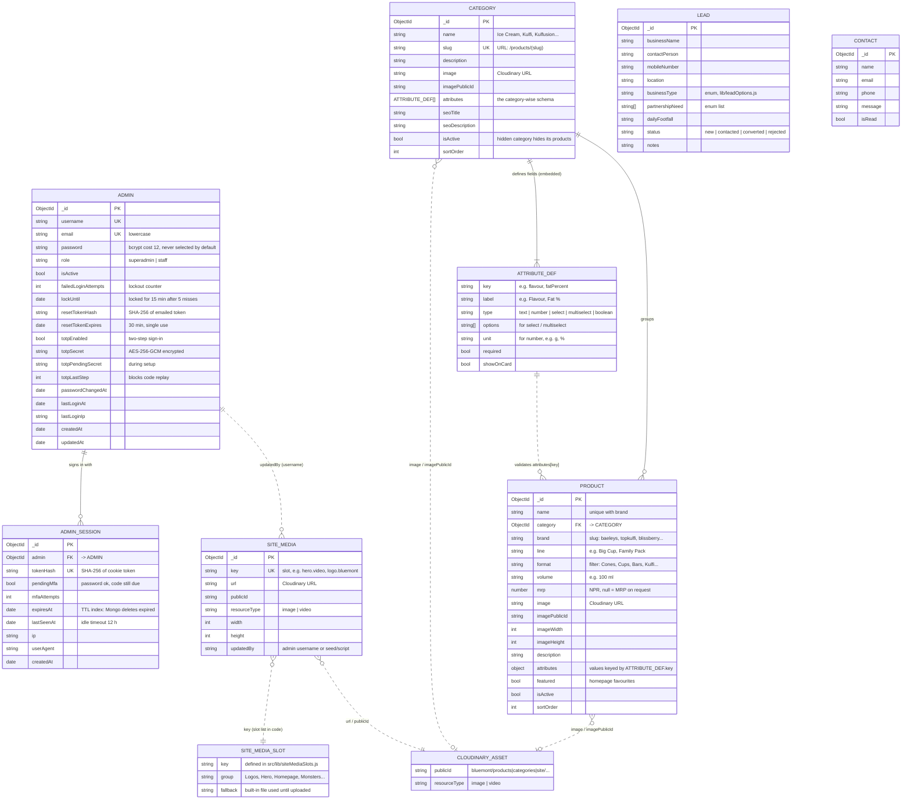
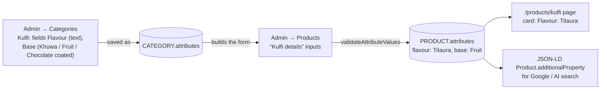

# Database schema

MongoDB (Mongoose models in `src/models/`). Images and videos are not stored
in the database: they live on Cloudinary, and documents keep the delivery URL
plus the Cloudinary `publicId` (so a replaced file can be deleted).

## Entity relationships

`LEAD` (partner applications) and `CONTACT` (contact form messages) stand
alone: they aren't linked to other collections. `SITE_MEDIA_SLOT` and
`CLOUDINARY_ASSET` are not collections. Slots are a list in code, and assets
live on Cloudinary. They are drawn here to show what the stored keys and URLs
point to.

## How the category-wise schema works

Validation lives in `src/lib/categorySchema.js`:

- `validateAttributeDefs()` checks a category's field list.
- `validateAttributeValues()` checks a product's values against it: types,
  required fields and allowed options. Unknown keys are dropped.

A field's `key` never changes after it is created, so renaming a field's
label keeps the values products already have.

## Legacy

`media` (model `src/models/Media.js`, route `/media/[id]`) held admin uploads
before the move to Cloudinary. `npm run migrate` copies any images still
there to Cloudinary. After that, the collection, the model and the route can
be deleted.
